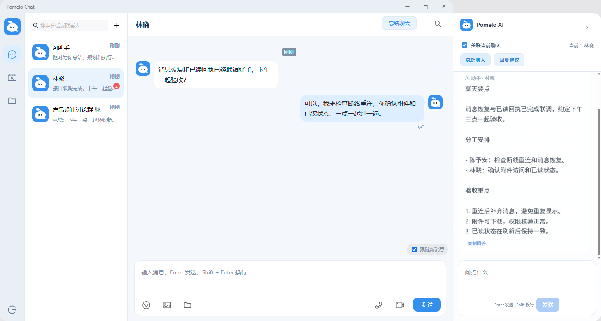

# Pomelo Chat

Pomelo Chat 是一个支持浏览器和 Electron 桌面的即时通讯项目，包含单聊、群聊、附件传输、音视频通话和 AI 助手。



截图使用演示会话和模拟 AI 回复，不代表真实模型效果。

## 已实现的功能

- **账号与联系人**：注册、登录、资料和密码管理、好友分组、建群与邀请成员。
- **聊天**：实时消息、历史搜索与定位、未读数、私聊已读回执；文字引用、文字转发、撤回自己两分钟内的消息和本地隐藏。
- **会话管理**：置顶、免打扰、标为已读和系统消息提醒。偏好保存在当前设备，按服务器和账号隔离。
- **附件**：分片上传、鉴权下载、聊天文件分页浏览；支持拖拽发送，一次最多 10 个文件，默认单文件上限 100 MiB，不支持文件夹。
- **音视频**：通过 LiveKit 提供语音和视频通话，需要单独运行 LiveKit 服务。
- **AI 助手**：流式问答、聊天总结、回复建议、个人待办和按用户隔离的记忆；发消息、保存待办和记忆写入需用户确认。
- **会话回顾**：按日期整理讨论、决定、问题和行动事项，附原消息引用；支持分段继续回顾、追问和起草回复。附件内容不参与解析，覆盖不完整时会提示。
- **桌面端**：聊天主窗口和助手侧栏、服务器地址配置、记住登录、草稿与待发队列恢复。侧栏支持消息草稿确认发送。

AI 草稿需要选择收件人、核对正文后确认发送；修改收件人或正文后必须重新核对。回顾和回复建议不会自动发送消息或保存任务，模型结论仍需结合引用核对。

## 技术结构

前端使用 React 18、TypeScript、Vite 和 Ant Design；桌面端使用 Electron。后端是 Express / TypeScript 模块化单体，使用 MySQL、Prisma 和 Redis，通过 HTTP、WebSocket 和 SSE 与客户端通信。AI 使用 LangChain 和模型兼容接口，并支持受权限控制的 MCP 工具。

消息先持久化到 MySQL，再由 Outbox 后台投递；客户端按消息 ID 合并，并通过历史记录补齐断线期间的消息。待发送消息保存在 IndexedDB，重试沿用原消息标识。系统包含限流和过载保护，这些机制不代表消息永不失败或可无限重试。

```text
client/          网页、聊天状态和助手界面
desktop/         Electron 主进程、预加载与打包脚本
server/src/      后端模块、数据库访问和后台任务
server/prisma/   Prisma 模型
tests/           测试与统一运行器
deploy/          反向代理配置
```

后端分为 identity、social、messaging、files、rtc、assistant、realtime 七个模块，详见 [后端架构](server/ARCHITECTURE.md)。业务接口前缀为 `/api/chat/v1`。

## 本地运行

准备 Node.js（20.19+ 的 20 系列、22.12+ 的 22 系列，或 24+）、pnpm 10、MySQL 8+ 和 Redis。先创建数据库，后端启动时执行表结构迁移，不自动创建数据库。

在项目根目录执行（PowerShell）：

```powershell
# 已有 .env 时不要覆盖，直接修改配置
Copy-Item server/.env.example server/.env
Copy-Item client/.env.example client/.env
corepack enable
pnpm install --frozen-lockfile
```

修改 `server/.env` 中的数据库连接、Redis 和 `JWT_SECRET`（至少 16 字符，替换示例值）。前后端默认端口为 5173 和 3000，前端连接配置见 `client/.env`。

```powershell
# 在两个终端分别运行
pnpm dev:server
pnpm dev:client
```

浏览器访问 `http://localhost:5173`。

AI 功能需要在 **服务端** 设置 `AI_API_KEY`、`AI_BASE_URL` 和 `AI_MODEL`，默认接口为阿里云百炼北京地域，模型为 `qwen-plus`。不要将模型密钥放进前端。

音视频需另行启动 LiveKit：

```powershell
docker compose -f docker-compose.livekit.yml up -d
```

本地默认地址为 `ws://127.0.0.1:7880`，默认凭据 `devkey` / `secret` 仅用于本地开发。连接其他实例时，在后端配置 `LIVEKIT_URL`、`LIVEKIT_HTTP_URL`、`LIVEKIT_API_KEY`、`LIVEKIT_API_SECRET`。公网通话还需配置安全连接、媒体端口及 NAT/TURN。

### 桌面端与构建

```powershell
# 保持后端运行，启动桌面开发环境
pnpm dev:desktop

# 构建前后端
pnpm build

# 构建 Windows 安装包，输出到 release/
pnpm build:desktop
```

安装包包含页面，不包含后端、数据库或模型密钥。首次启动需配置服务器根地址，服务端 `CORS_ORIGINS` 需允许 `pomelo://app`。当前安装包未签名，不提供自动更新。详见 [桌面端说明](desktop/README.md)。

## 部署

构建后运行 `pnpm --filter pomelo-chat-server serve`。生产环境需设置数据库连接、Redis、JWT 密钥及实际前端来源；完整配置见 [服务端环境变量示例](server/.env.example)。

仓库提供 Docker 和 Nginx 配置。在仓库根 `.env` 设置 `MYSQL_ROOT_PASSWORD`、`MYSQL_PASSWORD`、`JWT_SECRET` 后执行：

```powershell
docker compose up --build -d
```

网页入口为 `http://localhost:8080`。该 Compose 配置启动 MySQL、Redis、后端和网页，未包含 LiveKit，也未向后端传入 AI 或 LiveKit 环境变量；需要这些功能时应另行补充配置。互联网部署需配置 HTTPS/WSS、实际 `CORS_ORIGINS`，并仅在可信反向代理后设置 `TRUST_PROXY`。

- `/api/chat/v1/health` 检查进程存活；`/api/chat/v1/ready` 检查 MySQL 和 Redis。
- 附件默认保存在 `server/uploads`；`UPLOAD_ROOT` 相对路径以 `server` 为基准。多实例需共享附件目录。升级时应保留原目录配置。
- 自托管 LiveKit 应保留 `livekit.yaml` 中的 `room.auto_create: false`，由后端鉴权后创建房间。
- Prisma 用于查询与事务；表结构由现有迁移器维护，不要同时运行 Prisma Migrate 或 `db push`。见 [Prisma 说明](server/prisma/README.md)。

## 测试

```powershell
pnpm lint
pnpm test:unit
pnpm test:integration
pnpm test:e2e
pnpm test:desktop
```

集成与浏览器测试需要数据库、Redis 等环境；运行器按测试套件创建并清理隔离资源。`pnpm test:ci` 执行静态检查、构建和分层测试。真实模型和 LiveKit 测试有单独入口，普通测试通过不代表外部服务已验证。

具体依赖、命令和诊断方式见 [测试说明](tests/README.md) 与 [测试计划](docs/TEST_PLAN.md)；压测见 [压测说明](qa/benchmarks/README.md)。

## 当前限制

- 登录使用 Redis token 白名单，新登录会使旧登录失效，不支持多设备并行会话。
- “忘记密码”允许凭绑定手机号直接重置密码，当前不验证手机号归属；知道绑定号码的人即可重置对应账号密码。
- 系统消息提醒需要授权，客户端关闭后不提供离线推送；没有群聊已读成员列表。
- 置顶、免打扰、本地隐藏和通知开关不跨设备同步。撤回无法删除他人已保存或转发的副本。
- Redis 广播不保存离线消息，断线补齐依赖数据库历史；Outbox 达到重试上限后需人工处理，可通过服务端 `outbox:retry` 命令恢复。
- AI、外部 MCP 和音视频的可用性依赖相应服务配置，不能仅靠启动网页获得。

## License

ISC
