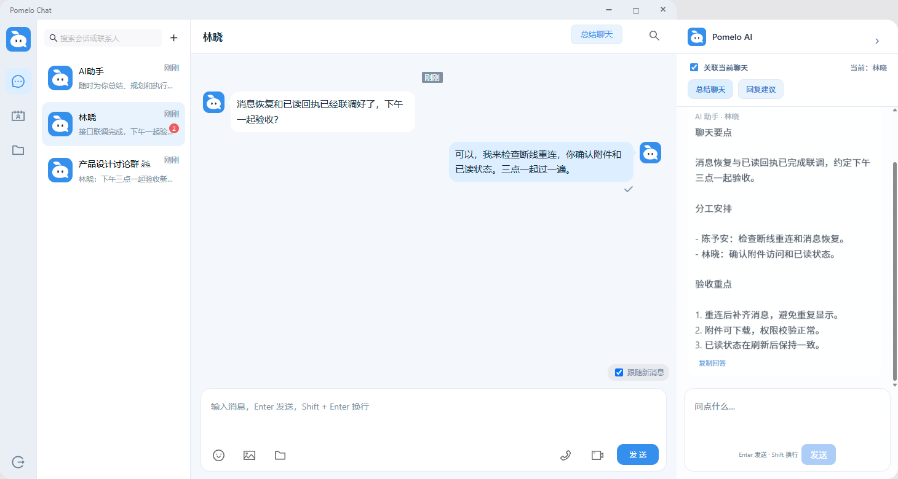
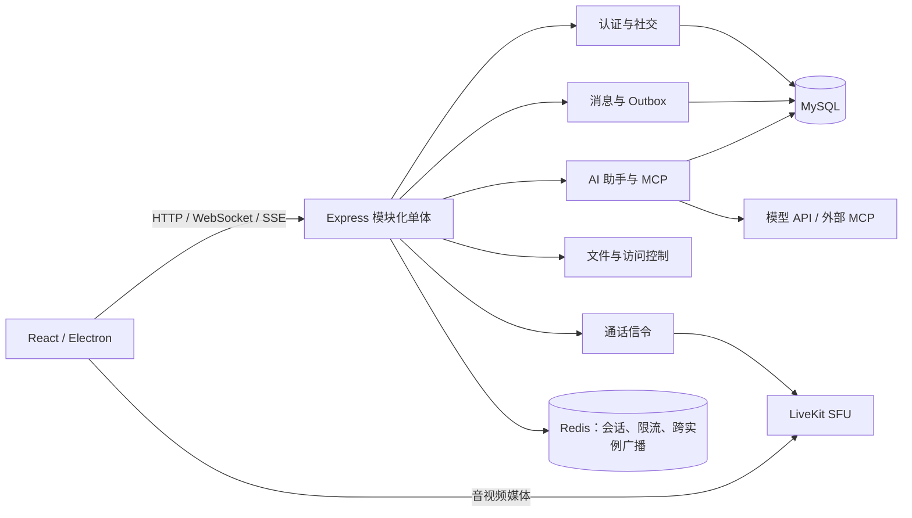

# Pomelo Chat

Pomelo Chat 是一个支持浏览器与 Electron 桌面的即时通讯项目，提供单聊、群聊、文件传输、音视频通话和 AI 助手。



当前桌面界面，使用演示会话与模拟 AI 回复。

## 项目架构

采用 **TypeScript 模块化单体**：后端在一个 Node.js 进程内运行，通过模块公开接口协作；SQL 集中在 repository 和 read-model 中，使用 mysql2 访问 MySQL，当前未引入 ORM 或 Go 服务。



| 层级 | 实现 |
| --- | --- |
| 客户端 | React 18、TypeScript、Vite、Ant Design |
| 桌面端 | Electron 主窗口与可折叠助手侧栏 |
| 后端 | Node.js、Express、express-ws，HTTP / WebSocket / SSE |
| 数据与状态 | MySQL 8+、mysql2、Redis / ioredis |
| AI | LangChain `createAgent`、兼容 OpenAI 协议的模型 API、MCP |
| 音视频 | LiveKit SFU，后端校验成员权限并签发房间 token |

后端划分为 `identity`、`social`、`messaging`、`files`、`rtc`、`assistant`、`realtime` 七个模块。跨模块通过 `public.ts` / `contracts.ts` 调用，`composition.ts` 组装依赖，`runtime.ts` 管理后台任务及资源关闭。详见 [后端架构](server/ARCHITECTURE.md)。

## 核心能力

- 注册登录、资料与密码管理、好友分组、建群及邀请成员。
- 单聊与群聊实时消息、聊天记录搜索、历史定位、未读数和私聊已读回执。
- 附件分片上传、合并及鉴权下载；LiveKit 语音和视频通话。
- AI 流式问答、聊天总结、回复建议、个人待办和用户隔离的记忆。
- 主聊天页支持确认式发消息、保存待办和记忆操作；桌面助手侧栏支持对话、总结、回复建议和复制。

### 消息可靠性与过载保护

发送消息时，MySQL 事务原子写入消息、房间序号、统计、附件引用及 Outbox；提交后返回 ACK，Outbox 按房间顺序异步投递，通过 Redis Pub/Sub 广播至其他实例。投递采用至少一次语义，客户端按消息 ID 合并，通过历史记录补齐断线期间的消息。

客户端用 IndexedDB 保存待发送消息，通过原 `clientMsgId` 核对与重试，服务端保证幂等。接收确认、发送成功和用户已读分别处理；私聊已读游标持久化并单调推进。

Redis Lua 原子扣减用户、房间和全局令牌桶，配合进程内排队上限、Outbox 积压采样和慢连接断开控制压力。HTTP 过载返回 `429` 与 `Retry-After`，WebSocket 返回可重试错误和等待时间；客户端保留消息 ID，执行有限次退避重试。

默认额度为用户 **5 条/秒，突发 10 条**，私聊房间 **10/20**，群聊房间 **20/20**，全局 **150/100**。单房间/进程排队上限为 **32/256**；Outbox 总待投递数、单房间待投递数、单房间最旧消息年龄的保护阈值为 **500/40/3 秒**，每两秒采样。这些是初始保护参数，部署后应结合实际硬件、群规模与接收延迟调整。

配置项集中在 [服务端环境变量示例](server/.env.example)。设置 `METRICS_TOKEN` 后，可用 `Authorization: Bearer <token>` 访问 `/internal/metrics`，采集积压、拒绝、排队和客户端接收确认延迟；留空则关闭访问。接收确认表示客户端解析消息，不代表用户已读。指标按进程累计，多实例需分别采集。

### AI 与确认式操作

保留一个主 LangChain Agent：上下文、待办和回复节点按意图并行执行确定性预处理，主 Agent 综合结果。所有写操作都需用户确认，服务端重新验证目标权限，并通过 Redis 原子状态转换控制重复执行。

总结与回复建议使用只读模式，不调用模型工具、不读取长期记忆，也不生成待确认操作。外部 MCP 按用户和工具白名单授权，写工具必须声明幂等参数并经过确认。模型凭据和 MCP 配置只放在后端。

## 本地运行

准备 Node.js 20、pnpm 10、MySQL 8+ 和 Redis。先创建 `DB_NAME` 对应的数据库；后端负责表结构迁移，不自动创建数据库。

首次配置（已有 `.env` 时直接修改）：

```powershell
Copy-Item server/.env.example server/.env
Copy-Item client/.env.example client/.env
corepack enable
pnpm install --frozen-lockfile
```

填写数据库、Redis、JWT 密钥；使用 AI 时再填写模型配置。前后端默认端口分别为 `5173` 和 `3000`。

```powershell
# 在两个终端分别执行
pnpm dev:server
pnpm dev:client

# 桌面端：保留后端运行，另开终端启动
pnpm dev:desktop

# 构建前后端
pnpm build
```

多人音视频需另外启动本地 LiveKit：

```powershell
docker compose -f docker-compose.livekit.yml up -d
```

默认 `ws://127.0.0.1:7880`，`devkey` / `secret` 仅用于本地演示。公网部署需另行配置 HTTPS/WSS、媒体端口和 NAT/TURN。桌面配置见 [桌面端说明](desktop/README.md)。

## 目录与接口

```text
client/           React 页面、聊天状态、发送队列与助手面板
desktop/          Electron 主窗口和助手侧栏
server/src/
  modules/        七个业务模块及其公开接口
  infrastructure/ MySQL、Redis、令牌桶、指标与 HTTP 基础设施
  read-models/    跨模块只读查询
  shared/         公共契约和业务无关工具
  mcp/            本地 MCP stdio server
  composition.ts  模块依赖组装
  runtime.ts      后台资源生命周期
qa/               浏览器回归、QA 与压测脚本
tests/            单元测试和数据库边界测试
```

业务接口前缀为 `/api/chat/v1`：`/auth`、`/friend`、`/group`、`/message`、`/file`、`/rtc`、`/assistant`。AI 请求统一使用 `/assistant/agent` 与 `/assistant/agent/stream`。

## 验证与文档

```powershell
pnpm lint
pnpm test:unit
pnpm --filter pomelo-chat-server test:architecture

# 读取本地 MySQL 凭据，自动创建并清理独立测试数据库
node server/scripts/run-isolated-tests.js backend
node server/scripts/run-isolated-tests.js system
node server/scripts/run-isolated-tests.js overload
node server/scripts/run-isolated-tests.js browser
```

`pnpm test:all` 需要预先配置独立测试数据库及 Redis；浏览器测试需安装 Playwright Chromium。普通回归使用确定性模型桩；真实音视频测试另需 LiveKit。

- [测试配置与命令](tests/README.md)
- [后端模块与事务约束](server/ARCHITECTURE.md)
- [桌面端开发](desktop/README.md)
- [压测脚本使用方法](qa/benchmarks/README.md)

报告和测试产物保留在本地，不提交到 Git。

## 当前边界

- 登录采用 Redis token 白名单，新登录会使旧 token 失效，尚不支持多设备并行会话。
- 尚无忘记密码找回流程、群聊已读成员列表；桌面侧栏尚无写操作确认入口。
- 文件默认存储于服务端本地目录；多实例部署需要共享文件存储。
- Outbox 保证已持久化消息可重试投递，Redis Pub/Sub 本身不提供离线重放；客户端通过数据库历史补齐。

## License

ISC
